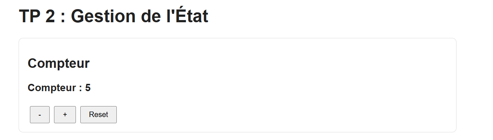
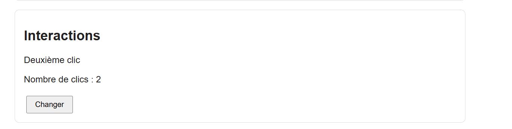
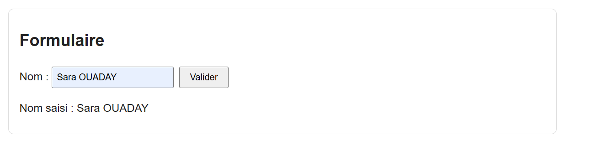
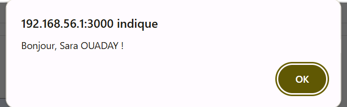
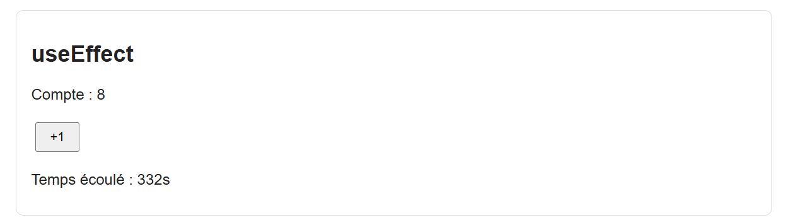
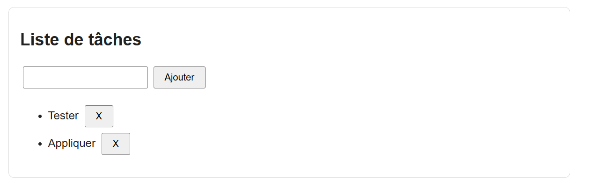
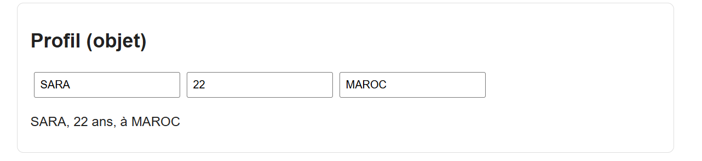

# TP 2 : Gestion de l'état local et interactions utilisateurs avec React

> **Réalisé par :** OUADAY Sara

## Objectifs

- Utiliser `useState` pour stocker des données dynamiques.
- Gérer les événements `onClick`, `onChange` et `onSubmit`.
- Utiliser `useEffect` et nettoyer les effets (cleanup).

## Structure

```
src/
├── App.js
├── App.css
├── Compteur.js
├── MessageBouton.js
├── FormulaireNom.js
├── CompteurEffet.js
├── Timer.js
├── TodoList.js
├── Profil.js
├── index.js
└── index.css
```

## Composants

### Compteur (`useState`)

Incrémenter, décrémenter et réinitialiser avec la forme fonctionnelle `setCompte(prev => ...)`.



### MessageBouton (`onClick`)

Le message change à chaque clic.



### FormulaireNom (`onChange`, `onSubmit`)

Formulaire contrôlé avec `event.preventDefault()`.





### CompteurEffet et Timer (`useEffect`)

Le compteur écrit dans la console à chaque changement. Le timer utilise une fonction de nettoyage avec `clearInterval`.




### TodoList

Ajout et suppression de tâches.



### Profil (état objet)

Mise à jour d'une partie de l'objet avec l'opérateur spread.



## Résultat final


## Conclusion

- `useState` pour l'état local (nombres, chaînes, tableaux, objets).
- Événements pour l'interactivité.
- `useEffect` pour les effets secondaires et leur nettoyage.
